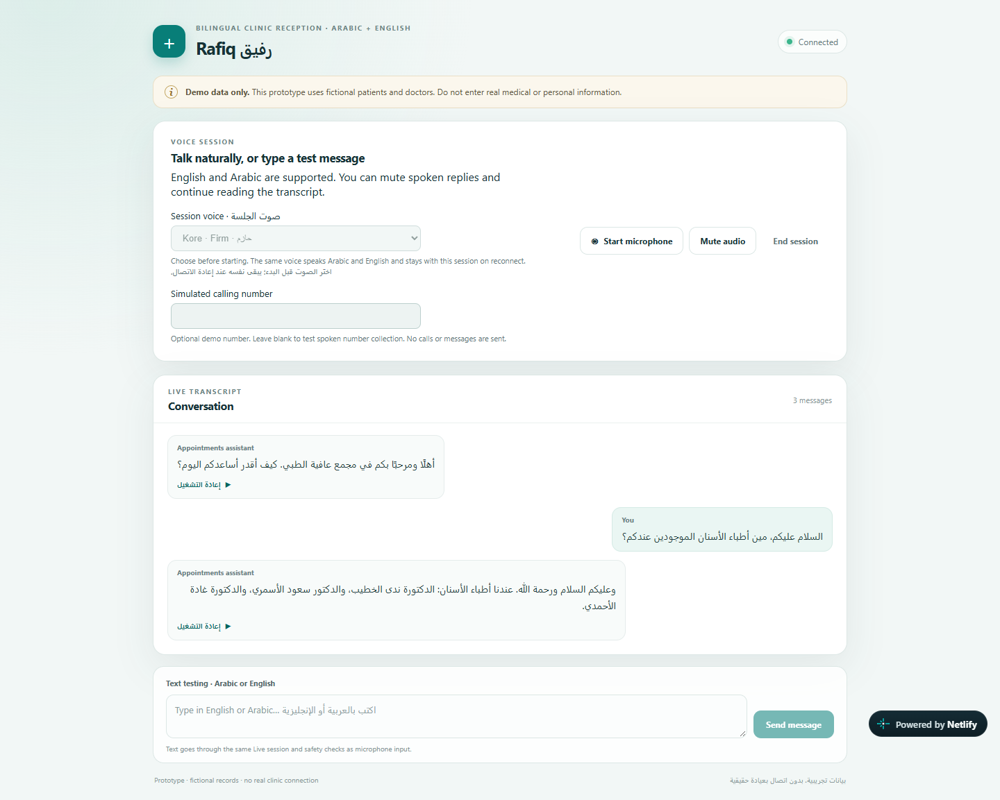

# Rafiq (رفيق)

Rafiq is an Arabic-first clinic receptionist prototype built with Gemini Live, with English support. It answers questions about doctors and helps manage fictional appointments through voice or text, using database functions for doctor details, availability, and confirmed appointment changes.

Rafiq is a personal project I built with assistance from AI coding tools. My work covered conversation design, architecture, implementation, testing, and deployment.

[Try the live demo](https://rafiq-health.netlify.app/). A simple starting point is to ask about the dental department in Arabic or English.



*An actual exchange from the live demo, using typed Arabic input and generated replies.*

The project explores how a voice agent can feel like a helpful receptionist, with particular attention to natural Saudi Arabic and a friendly, professional tone. Its directory contains 30 fictional doctors across 10 specialties. Callers can find available times, book appointments, and request rescheduling or cancellation after confirmation. Confirmed changes persist so later sessions see updated availability. The web app includes a live transcript, replayable audio replies, and a choice of voices.

Repeated live conversations in Arabic and English guided changes to pronunciation, tone, and how the agent understood requests. Testing covered misunderstood names, incomplete phone numbers, changed appointment choices, and interrupted replies, alongside automated checks of booking behavior.

A secondary goal was to assess BMAD and other AI coding skills through practical use in planning, architecture, implementation, reviews, and documentation. Their usefulness was evaluated through the resulting work and issues found during testing.

The app uses React, TypeScript, and Vite. Gemini Live handles speech and function calls, while Express runs in Netlify Functions and stores demo records in Netlify Database (PostgreSQL).

## Run locally

Local setup requires Node.js/npm and a Gemini API key with access to the configured Live model.

1. Clone the repository and install dependencies:

   ```sh
   git clone https://github.com/AbdulrahmanAlguydi/rafiq.git
   cd rafiq
   npm install
   ```

2. Copy `.env.example` to `.env` and set `GEMINI_API_KEY`.
3. Start the app with `npm run dev`.
4. While it is running, apply the local database migrations from a second terminal with `npm run database:migrate`.

The app runs at [localhost:5173](http://localhost:5173). Select a voice before starting a session, then use the microphone or text box. The API key stays in the local environment file.

Run `npm test` for offline checks and `npm run build` for the production build. The [Netlify guide](docs/hosting-options.md) covers deployment and database setup.

## Prototype limits

All records are fictional, and the demo has no phone or hospital integration. It is intended for monitored demonstrations with made-up details and does not provide medical advice. Recognition and spoken replies can still be wrong, even when server functions correctly validate an appointment change.

More detail: [Development and test notes](docs/developer-notes.md) · [Product design](docs/health-voice-agent-design.md) · [Decisions and lessons](docs/decision-log.md)
