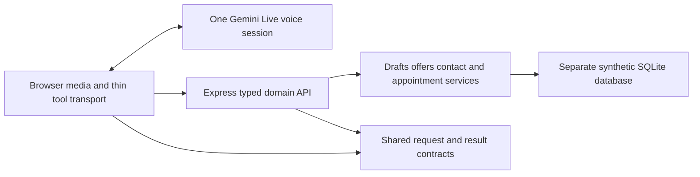

# Architecture Spine — Resource-centered receptionist

## Design Paradigm

**Target only; not implemented.** Gemini owns dialogue. Typed domain resources own transactional facts and acceptance. The server does not direct every spoken turn or enforce a collect-doctor/time/contact conversational stage machine. This refines the existing replacement design's server action context; the current app remains described by the separate prototype spine.

## Invariants & Rules

### AD-1 — Separate dialogue from domain ownership

- **Binds:** speech, appointments, contact
- **Prevents:** competing browser/server stage and approval flags or loops caused by media driving intake.
- **Rule:** Gemini decides conversational order and wording. The server alone persists the active draft, immutable offered choices, acceptance, contact capture and results. Browser snapshots are read-only mirrors, never a second booking authority. Functions return facts/missing fields/errors, not compulsory ordinary spoken lines. Audio lifecycle does not erase domain data.

### AD-2 — Free native speech with a stable persona

- **Binds:** speech
- **Prevents:** scripted lines, output withholding, doubled voices and caption-dependent stalls.
- **Rule:** retain one Gemini Live voice configuration, urban Hejazi Arabic and English. Adapt the supplied prompt to our clinic and capabilities; no preplayed greeting claim or fixed ordinary replies. Stream audio chunks, cancel queued stale audio on interruption, retain immutable transcript turns and replay without invoking tools. No second runtime output judge. Captions are not a required substring/word evidence check before speech or booking.

### AD-3 — Acceptance is specific, not generic

- **Binds:** appointments, contact
- **Prevents:** service yes/phone yes approving an unoffered slot, double booking confirmation or stale subject approval.
- **Rule:** immutable offers identify action kind, target person/appointment, doctor/service and exact date/time/capacity. Semantic acceptance references that server-issued offer and subject/selection revision plus a subsequent caller-turn identifier and the assistant output that presented it. Issuing a tool result alone is not presenting an offer. Shared exposure events distinguish not-started, started, interrupted and completed output; no full-playback or exact-caption gate. A known never-presented offer cannot be accepted by a generic yes; validate and clarify the caller's exact requested details instead. Interrupted/uncertain exposure is context for semantic clarification, not automatic cancellation or a repeated fixed readback. Contact confirmation is separate. Changing doctor/time/service/person/target/action invalidates relevant acceptance; collecting a name/contact for the same subject does not re-ask slot acceptance. Server validates identifiers/revisions/turn ordering, not exact captions. The model's assertion that details were conveyed is not proof of understanding.

### AD-4 — Repair contacts without losing the request

- **Binds:** contact, recovery
- **Prevents:** three digits causing a generic failure, duplicate chunk append, fabricated digits or family records merged by phone.
- **Rule:** immutable simulated calling metadata is separate from editable contact. Blank metadata is unknown. Contact capture persists raw chunks, normalized digits, count and confirmed version; append/correct/restart updates use deduplicated event IDs and explicit versions. Deterministic supported grouping rules preserve zeros; ambiguity returns a targeted issue without padding/trimming. Confirm dictated complete digits once. A shared phone is a contact, not unique patient identity; no mandatory patient ID/DOB/national identifier.

### AD-5 — Atomic effects and recoverable results

- **Binds:** appointments, recovery, simulation
- **Prevents:** duplicate writes, false failure after commit, rescheduling creating two appointments or cancelled slots remaining occupied.
- **Rule:** server prepares one operation ID bound to the validated payload and expected draft/appointment versions. Same ID/same payload returns its durable result; changed payload under that ID is rejected. Commit acceptance checks, time/policy/capacity checks, patient/appointment/history, active occupancy, result and simulated effects in one immediate SQLite transaction. Only active occupancy is unique per capacity unit; reschedule preserves appointment identity and failed moves preserve old occupancy. Unknown outcomes reconcile the same ID before another mutation. No automatic waitlist promotion or real external delivery.

### AD-6 — Serialized lifecycle, not transport-driven mutations

- **Binds:** recovery, appointments
- **Prevents:** late responses reviving stopped drafts or reconnect repeating a saved mutation.
- **Rule:** persist a small session envelope with immutable calling metadata, active request and completed/unknown operations; serialize its mutations with version checks. A disconnect retains it. Explicit end or an emergency override establishes a serialized admission fence: requests not committed before that fence cannot subsequently commit, and queued/delayed preparations cannot revive the draft. Commit checks active session/request status within its transaction. A commit transaction already linearized before the fence may settle and its durable result stays retrievable; closing never rewrites a committed result as cancelled. Emergency pauses preserved draft details and invalidates uncommitted consent/operations; correction may resume under a new revision. Explicit end closes the draft. Reconnect first fetches authoritative state, then resumes the provider if verified-supported or reconstructs compact context; it never replays writes. Bounded retries return unresolved truthfully rather than looping.

### AD-7 — Database-only knowledge and administrative scope

- **Binds:** knowledge, appointments, speech
- **Prevents:** invented doctor availability/policies/prices, unrestricted clinical advice or fictional emergency destinations.
- **Rule:** preload versioned compact stable clinic/doctor/specialty facts from SQLite; query detailed knowledge and current availability. No external search/SQL-generating agent. Missing facts produce an honest unknown result. Routing uses synthetic administrative mappings and at most two clarifications, not diagnosis/provider ranking. An explicit current emergency gets nearest-hospital emergency-department guidance; stop new routine writes, preserve committed results, and distinguish current reports from negation/hypotheticals/corrections. Store policies, including synthetic late/no-show classification below 24 hours, separately from occupancy/status.

### AD-8 — Measure effects and speech separately

- **Binds:** all
- **Prevents:** passing private-flag tests being treated as proof of natural speech or successful appointments.
- **Rule:** use disposable database and injected-clock tests for domain invariants, adapter event-sequence tests for ordering/interruption/recovery, repeated Arabic/English live conversations for semantic behavior, and actual listening/microphone trials for Hejazi voice and numbers. Log session/connection/turn/offer/operation IDs, revisions, arguments/results, state changes and segmented latency; exclude credentials/raw audio base64. Retire obsolete gate/phrase tests with a failure-to-new-scenario map, not by deleting evidence of unresolved defects.

## Consistency Conventions

| Concern | Convention |
| --- | --- |
| Requests | Shared discriminated contracts for book/move/cancel and field patches. Adapter supplies session/connection/input-turn/tool-event IDs; Gemini supplies semantic arguments, not fabricated transport IDs. |
| Results | Typed status, facts, issues/missingFields, draft snapshot/version and optional operation ID. Recovery status distinguishes not-started, committed, rejected and unresolved. No generic failure may assert that a possibly committed action failed. |
| Acceptance revisions | Separate subject/selection and contact versions; overall draft version controls edits. Contact repair invalidates prepared operation payload, not unchanged slot acceptance. |
| Subject identity | Server assigns a stable draft subject key even before its name is known. Naming/correcting that same subject changes its label; switching to another person changes the key and invalidates subject acceptance. Phone alone never merges subjects. |
| Contact format | Supported Saudi inputs normalize to ten-digit local `05…` strings, matching the current field helper; equivalent `+9665…` is accepted at boundaries. Persist raw dictated digits separately, including invalid partial counts. No other country format is implied. |
| Exposure/turn attribution | Adapter supplies monotonically ordered session event IDs and input/output IDs. Decision arguments identify the offer; the carrier binds the producing output and current caller turn. Exposure status is distinct from offer issuance and semantic detailsCommunicated. Do not stall waiting for a final caption or interpret playback completion as approval. |
| Serialization | One active appointment action per session; sequential family actions retain independent results. Concurrent stale mutations return latest snapshot and conflict, not last-writer-wins. |
| Time | Injected server clock; UTC storage, Riyadh timezone and code-derived Gregorian/Umm al-Qura/relative labels. Refresh context at startup/reconnect/time-sensitive results and across local midnight. |
| Tool set | Small purpose-specific functions; no unrestricted execute/SQL tool, broad catch-all failure or tool for every conversational phrase. Supported compound read requests may run together; dependent mutations remain serialized. |
| Deployment | Existing local browser + Express process + SQLite, one Gemini provider; no telephony, distributed queue, workflow framework or production deployment. Exact provider/token capabilities are probed before async tools/resumption. |
| Migration | Backup existing prompt/source/untracked files and consistent old DB before runtime replacement. Separate synthetic DB, one API/adapter path selected per session; never mix old and new authoritative gates. |

## Capability → Architecture Map

| Capability | Target owner | Decisions |
| --- | --- | --- |
| Hejazi/English voice, typed testing, transcript/replay | Gemini + browser media | AD-1, AD-2, AD-8 |
| Clinic/doctor/service facts and light signposting | Knowledge/directory functions + SQLite catalogs | AD-7 |
| Partial/corrected phone and simulated calling metadata | Contact resource + session metadata | AD-4 |
| New/proxy/family booking | Draft/offer/appointment domain services | AD-3, AD-5, AD-6 |
| Lookup/move/cancel and late policy | Appointment service + history/active occupancy | AD-3, AD-5, AD-7 |
| Waitlist/callback and simulated transfer/message/summary link | Typed follow-up resources + local activity records | AD-5, AD-7 |
| Recovery/ending and segmented diagnostics | Session/operations + browser lifecycle | AD-6, AD-8 |

## Deferred

- Exact field schemas/function signatures and recovery timeout values belong to the next focused implementation plan; they must implement the revision/ownership conventions above before code starts. No implementation readiness claim from this design alone.
- Provider async/resumption capability is a measured probe, not assumed support. Synchronous tools plus application-context reconstruction are the baseline.
- STT/TTS, Gemini audio relay or LiveKit integration require failed live voice/media acceptance or a measured adapter limitation; none is selected now.
- Production authentication, real medical data/telephony/SMS, distributed execution and clinical validation are outside this synthetic monitored prototype.
