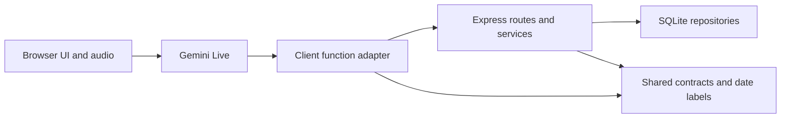

# Architecture Spine — Voice prototype

## Design Paradigm

The running app is a browser conversation adapter over an Express/SQLite application. Gemini Live generates speech and calls declared functions; it cannot write SQLite directly. Client tools currently own much of intake and delivery state. The broader replacement described in the design document is a target, not an implemented server-owned conversation workflow.

## Invariants & Rules

### AD-1 — Database-backed facts [ADOPTED]

- **Binds:** directory, booking, conversation
- **Prevents:** plausible but invented doctors, availability and successful bookings.
- **Rule:** doctor and appointment facts come from function results. Caller preferences may change a request, not database facts. A successful booking requires a confirmed service result, never merely a model utterance.

### AD-2 — One approval, one durable operation [ADOPTED]

- **Binds:** booking, recovery
- **Prevents:** duplicate writes or false failure after a lost successful response.
- **Rule:** commit slot, appointment, guest profile when needed, and result keyed by pending ID in one immediate transaction. Retrying that approved ID returns the saved result, including after service restart. Unknown response outcomes retain the handle and original approval; they cannot start another mutation until reconciled.

### AD-3 — Transport is not cancellation [ADOPTED]

- **Binds:** recovery, conversation
- **Prevents:** reconnection silently abandoning the appointment and restarting intake.
- **Rule:** unexpected connection loss stops media but retains local booking context. A reconnect sends structured recovery state rather than a new greeting. Explicit stop can cancel an uncommitted draft, but must first reconcile an unknown commit outcome. A service restart can lose uncommitted in-memory drafts; return expiration/not-found rather than claim a booking.

### AD-4 — Natural speech without another output controller [ADOPTED]

- **Binds:** conversation
- **Prevents:** repeated scripted responses and verification latency returning as accidental architecture.
- **Rule:** use Gemini Live directly for Arabic/English speech; no prerecorded response layer or second model checking spoken wording in the normal app path. Keep write validation in contracts/services. Existing local consent/delivery gates are legacy boundaries to replace incrementally, not a template for adding more sentence matching.

### AD-5 — Verify effects, not spoken claims [ADOPTED]

- **Binds:** diagnostics, booking, recovery
- **Prevents:** a passing conversation masking a failed or duplicate database operation.
- **Rule:** booking regressions assert database rows and operation results using disposable databases. Test lost responses, repeated approval, rollback, reconnect and explicit stop. Offline tests do not certify actual microphone transcription, dialect, voice consistency or provider latency; those require live tests and logs.

## Consistency Conventions

| Concern | Convention |
| --- | --- |
| Ownership | Provider owns dialogue/audio; client owns media and current legacy intake; server owns validation and database effects. |
| Time | Persist UTC; derive Riyadh/Gregorian/Hijri labels from application time, not model guesses. |
| Changes | Add schema compatibly; never reset the persistent demo database as an implementation side effect. |
| Operations | Local prototype: Vite browser plus Express API, Gemini as the sole live provider; no telephony or production deployment assumed. |
| Diagnostics | Correlate turns, tool outcomes and database results; never print credentials. |

## Capability → Architecture Map

| Area | Lives in | Governed by |
| --- | --- | --- |
| Arabic/English voice, typed testing | client/voice, shared live prompt | AD-4, AD-5 |
| Doctors and availability | server repositories/services, client tool adapter | AD-1 |
| Registered and guest booking | client/agent/tools, server bookingService | AD-1, AD-2 |
| Lost-result recovery and reconnect | booking_results, tools, voice/session | AD-2, AD-3 |
| Debugging and regression evidence | client diagnostic logging, tests, scripts | AD-5 |

## Deferred

- Expanded replacement prompt/workflow, appointment management policies and light department signposting remain the design document's target. They are not silently enabled by this audit.
- Move semantic booking state and approval evidence to a small server-owned session when implementing that replacement. Keep the browser focused on media; retire superseded gates and tests together. Do not add a generic workflow framework.
- Reload/crash recovery of uncommitted drafts and multi-process scaling are outside the local prototype's current durability guarantee. Confirmed results persist; browser reconnect is not page reload recovery.
- Live accent, transcription and latency tuning require the provider and actual listening. No claim that these correctness fixes eliminate model errors.
